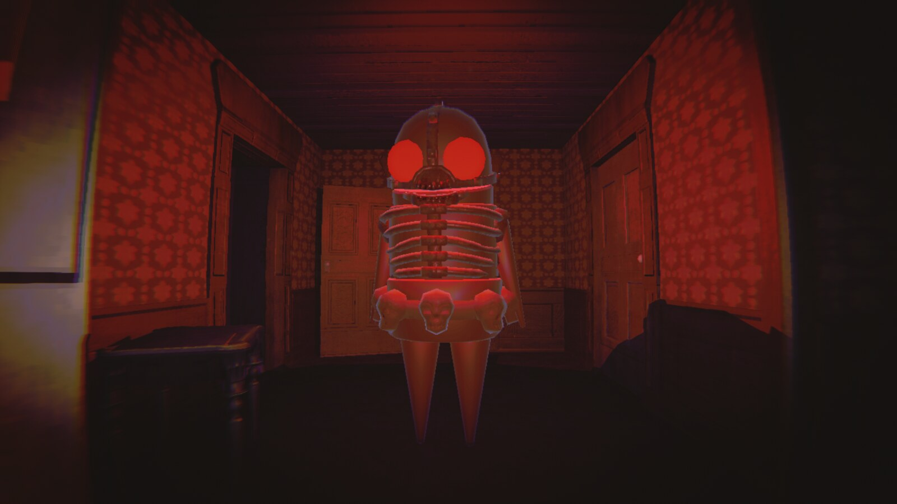
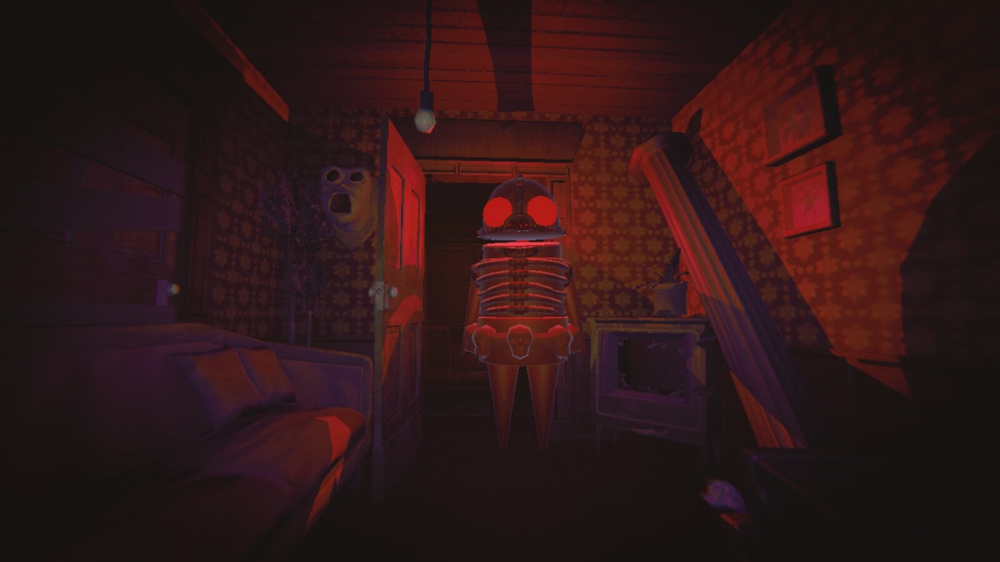
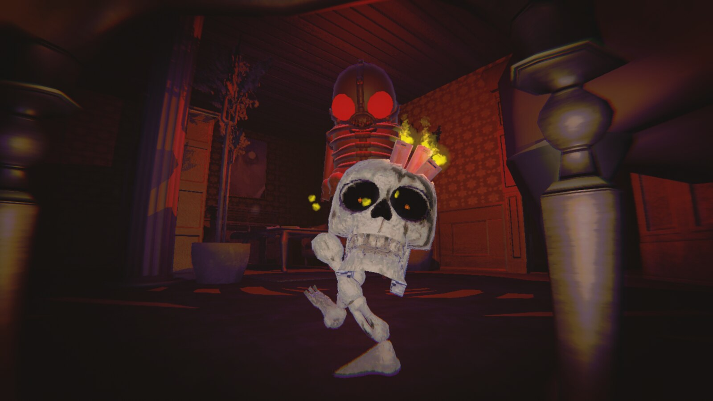
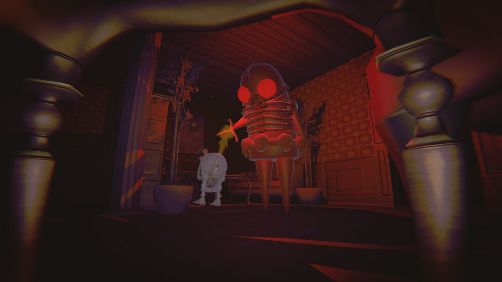
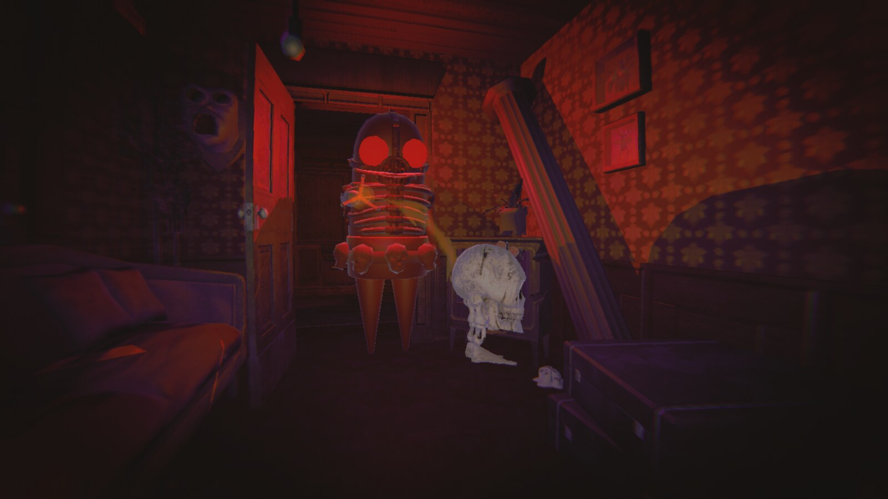
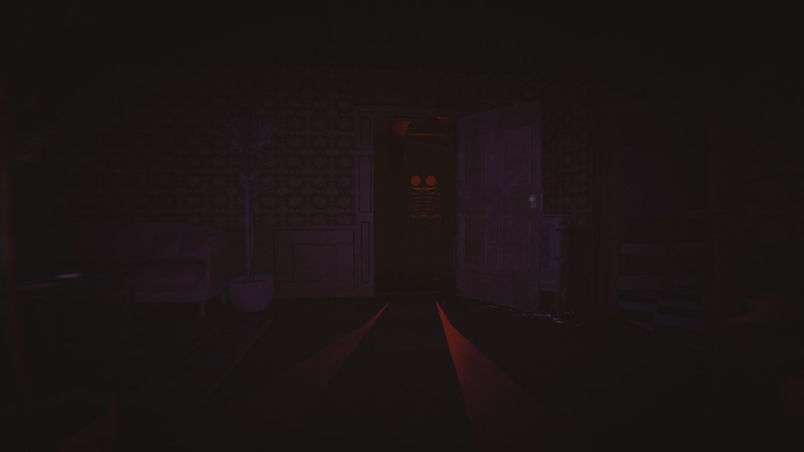
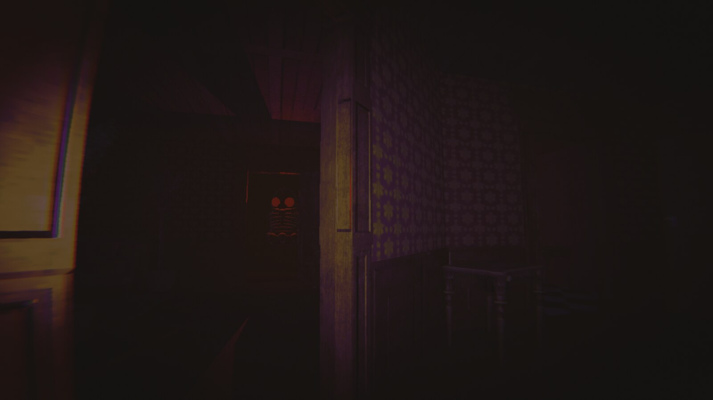

# Hunted

> **Early development.** This mod is being worked on actively and changes often. Expect rough edges, and check the changelog when you update.

An asymmetric mode for R.E.P.O., inspired by Dead by Daylight. One player is **the killer**: invulnerable, fast, huge and armed with a sword. Everyone else is a **survivor** who has to fill the extraction points with valuables and escape in a truck.

**Everyone in the lobby needs Hunted and MenuLib, on the same version.** Install it from [Thunderstore](https://thunderstore.io/c/repo/p/Prussian/Hunted/) with a mod manager such as Gale.

## How a round works

- The host ticks the killer's box in the lobby. If nobody is ticked, the killer is random.
- The killer starts in the **killer room** in the middle of the map, and survivors start far from it.
- Survivors need one completed extraction point per survivor, and there are spares. More survivors make a longer map.
- Once enough points are done, both trucks open. Survivors win when every living survivor is inside one.
- The killer wins by killing every survivor, or when the time limit runs out (15 minutes by default).
- Dead survivors leave a head that teammates can bring back, as in the normal game.
- Only small valuables spawn, and they respawn over time. There are no monsters by default.

## The killer

- Cannot be hurt or tumbled, cannot sprint, and cannot enter the trucks or pick up valuables, carts or heads.
- **Sword:** oversized and hurts only survivors. It runs on energy, which drains over time and with each hit, and recharges in the killer room. It can be stowed but not dropped, and stowing it lets the killer walk at full speed.
- **Bomber heads (key 2):** three uses, and one comes back every 30 seconds. Throw one and it hunts the nearest survivor, then explodes for triple damage.
- **Killer room:** the killer is faster and hits harder here, and any survivor inside is revealed through walls and on the map.
- **Map:** zoomed out, but shows no heads, carts, items or valuables.
- **Falling:** the killer floats back out of holes.

## How the killer finds survivors

- **Standing** survivors are always visible, even through walls.
- **Crouching or tumbled** survivors appear after the killer looks towards them from close by for a moment. **Crawling** takes much longer.
- Survivors beside or behind the killer, or farther than about 20 m, are not noticed.
- A survivor who takes damage is visible for at least 3 seconds.

## Survivors

- Start with 200 health and slowly regenerate.
- **Boost:** when revived, or hit down to half health or less, a survivor runs without tiring and cannot be tumbled for a few seconds.

## Bots

A slider in the lobby adds up to 5 bot survivors, with any number of players. They gather valuables, sneak, flee, hide, carry heads to safety and escape in the trucks. They get hurt and die like players, and the killer has to kill them too. Players cannot grab them.

## Playing

Singleplayer, Public Game and Tutorial are hidden while the mod is installed. Use **Host Hunted** or **Join Hunted** in the main menu, and disable the mod to play the normal game.

If you play alone, nobody is the killer unless you tick your own box, and a killer on their own needs at least one bot.

## Screenshots

## Settings

The config file is `BepInEx/config/Prussian.Hunted.cfg`. In a lobby, the host's values apply to everyone.

| Setting | Default | What it does |
|---|---|---|
| Killer / WalkSpeedMultiplier | 2 | Killer walking speed relative to a normal player |
| Extraction / GoalPerPointInHundreds | 150 | Value that completes an extraction point, in hundreds of dollars (150 is $15,000) |
| Extraction / TimeLimitMinutes | 15 | The killer wins when this runs out |
| Survivor / MaxHealth | 200 | Health everyone starts with |
| Survivor / RegenPerSecond | 0.5 | Health regenerated per second (0 turns it off) |
| Survivor / BoostSeconds | 5 | Length of the boost (0 turns it off) |
| Sword / DamagePerHit | 35 | Damage to a survivor per hit |
| Sword / EnergyPerSurvivorHit | 10 | Sword energy lost per hit (out of 100) |
| Sword / EnergyDrainPerSecond | 0.55 | Sword energy lost per second |
| Sword / ChargePerSecond | 10 | Sword energy regained per second in the killer room |
| Vision / KillerFogStart, KillerFogEnd | 5, 30 | The killer's fog distances |

## Compatibility

- Requires **BepInExPack** and **MenuLib**.
- Mods that change the main menu, the lobby list, player cosmetics or level generation may conflict.
- Please send bug reports with the host's `BepInEx/LogOutput.log`.

## License

[MIT](LICENSE)
